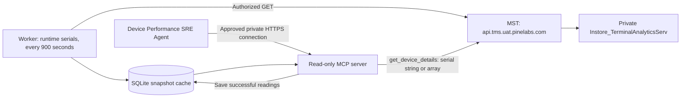

# Device Performance SRE Agent

A local MCP connector plus an independent 15-minute polling worker for the existing MST/Terminal Analytics services. Pass **one serial string or an array at runtime**; there is no required serial list in configuration. MST calls are GET-only. Successful readings are cached, compared and supplied with performance recommendations. The AgenticOrg agent explains those results after you connect it.

## Tokens and the complete request path

```text
AgenticOrg -- dedicated MCP token --> MCP connector
MCP connector/worker -- MST access token + requested serial --> MST
MST -- private service call --> Instore_TerminalAnalyticsServ
Successful metrics --> local SQLite cache --> comparisons/history --> SRE agent summary
```

The two credentials serve different connections:

| Setting in `.env` | Actual token location | Used for |
| --- | --- | --- |
| `MST_TOKEN_FILE=data/mst-token` | `data/mst-token` | Connector/worker sends `Authorization: Bearer ...` to MST to retrieve analytics. |
| `SRE_MCP_TOKEN_FILE=data/connector-token` | `data/connector-token` | AgenticOrg authenticates to the connector's HTTP `/mcp` endpoint. Generate a dedicated credential for each installation; no token is included in Git. |

To configure the MST credential:

1. Sign in to the approved **UAT TMS/AppMarketplace portal** with a permitted account. The reviewed portal code stores the Identity login's `access_token` under **Developer Tools → Application → Local Storage → portal origin → `accessToken`**. Copy only its value. AgenticOrg login is a separate session and does not supply the MST credential.
2. From this project folder run `./run-local.sh configure-token`. Paste the approved token at the hidden terminal prompt. The command saves it atomically to the path configured by `MST_TOKEN_FILE`, with permissions `0600`, and prints only the path/status. It does not mint a token, validate it at MST or echo its value.
3. Run `./run-local.sh doctor`. This reports the credential sources/paths, API route and local readiness without displaying credentials or calling the network. `available` means readable and formatted; the next live test verifies validity and device access.
4. Run `.venv/bin/python scripts/check_mcp.py --transport stdio --serial-numbers 'YOUR_SERIAL' --details-only`. This prints only the device-details JSON, uses the actual MCP protocol and calls MST; it starts its own local server. Pass several serials after `--serial-numbers` for a batch. There is no required serial list in `.env` or `monitor.json`.
5. After live sampling works, run `./run-local.sh poll --serial-numbers 'SERIAL_1' 'SERIAL_2'` for collection every 900 seconds, and `./run-local.sh serve --transport streamable-http` in a second terminal for the agent connection. The cache file is `data/snapshots.sqlite3`; observations are available for date queries from collection onward.

The MST token must have the device-details scope, an accepted client and appropriate merchant/device context. Ask the TMS/IAM owner for this access if the account lacks it. The token expires: for a short local test, repeat `configure-token` with a renewed access token. For continuous operation use an approved refresh process or approved service identity supported by deployed MST policy. The connector re-reads the file on each request; it does not persist portal passwords or guess an OAuth grant. Use a dedicated authorized scope/cache when deploying beyond the local pilot.

Keep tokens in local secret files or a secret manager. The agent prompt contains tool instructions and serial parameters only. AgenticOrg receives the dedicated **MCP** credential through its connector secret configuration; the MST credential stays on the connector host. The connection and tool-selection checklist below follows the Pine Labs guide.

## Implementation and source review



The reviewed local code establishes this request:

```http
GET https://api.tms.uat.pinelabs.com/v1/mst-sync/analytics/device-details
Authorization: Bearer <MST credential resolved by worker>
hardware-serial-number: <runtime hardware serial>
x-correlation-id: <generated per polling request>
```

- MST `AnalyticsController` exposes that route. `TerminalAnalyticsApiServiceImpl` validates the requested terminal against the caller's merchant context and forwards it to private analytics as `hardware_serial_number`.
- The required scope is `com.pinelabs.appstore.analytics.devicedetails`; the controller currently accepts the configured `tms-web` client. A generic client-credentials token may fail the existing `azp`/client check. Use an approved credential supported by the deployed MST policy; no authorization checks were removed.
- Analytics returns `TerminalDataResponse`; MST unwraps it into `{"data":{"device_details":{...},"app_data":{...}}}`. Empty/failed responses can be HTTP 200 with null data. The adapter treats them as failed polls, preserves earlier data and records the failure.
- `/device-details/audit` reads deletion audit records. It is not continuous metric history. There is no date-range query for current device metrics in the reviewed route.

This project supplies **observation-time history from polling onward**. It cannot backfill earlier dates or retrieve intermediate device readings that were overwritten between polls. Existing service code is unchanged. The deployed UAT gateway path and a real response still need a live check; source review and mock tests do not prove the deployed version is identical.

## Local setup

Python 3.11+ on macOS/Linux is required (`fcntl` supplies worker exclusion). Dependencies are already installed in this machine's `.venv`. For a fresh checkout:

```sh
cd DevicePerformanceSREAgent
python3 -m venv .venv
.venv/bin/python -m pip install -r requirements.lock
.venv/bin/python -m pip install --no-deps -e .
cp monitor.example.json monitor.json
cp .env.example .env
```

Credentials, `.env`, local monitoring settings and cached device data are excluded from Git. On a fresh installation, create the configuration from the examples and provision both credentials. Preserve existing credentials when repeating setup.

1. Pass serial strings in each MCP request or use `--serial-numbers` on the worker/test client. Preserve leading zeros. No serial-file edit or MCP server restart is needed to select another device. `monitor.json` contains operational settings; a legacy `devices` key remains accepted only as an optional worker default, never an MCP allowlist.
2. Run `./run-local.sh configure-token` to save a valid approved MST bearer token using hidden input, or use your secure local editor/secret workflow to write it **without** the `Bearer ` prefix into `data/mst-token` with mode 600. `.env` points to this file. Run `./run-local.sh doctor` to check availability. Do not paste tokens into chat, prompts, tracked files or terminal commands/history. Alternatively inject `MST_BEARER_TOKEN` into the process environment and unset `MST_TOKEN_FILE`.
3. The worker re-reads the token file on every request. An existing approved refresh process can atomically replace it. This connector does not invent an OAuth endpoint or implement a guessed refresh grant. Expiry/401/403 is surfaced and never bypassed.
4. Review pilot thresholds in `monitor.json`. RAM/storage/CPU defaults are 85% and a 10-percentage-point increase. Existing configs that omit the new CPU threshold receive its default; override `cpu_used_percent` if needed. These are configurable review triggers, not vendor limits or production SLOs. Signal units default to unverified (`null`); only set an interface to `"dBm"` after the owner verifies its collector contract. Raw error codes are never treated as incident counts.

Run one real poll to verify the deployed contract:

```sh
./run-local.sh once --serial-numbers 'YOUR_SERIAL'
# Or collect several devices in one run:
./run-local.sh once --serial-numbers 'SERIAL_1' 'SERIAL_2'
```

An unsuccessful device poll exits 2; missing configuration exits 1. Successful output contains minimized telemetry and should stay private. Then run these **separate foreground processes**:

```sh
./run-local.sh poll --serial-numbers 'SERIAL_1' 'SERIAL_2'
```

```sh
./run-local.sh serve --transport streamable-http
```

HTTP MCP listens at `http://127.0.0.1:8765/mcp` and requires the **separate MCP credential**. `/healthz` reports only process liveness. Use `get_monitor_health` to check recent collection activity. Local stdio clients can use `./run-local.sh serve --transport stdio`; they do not need an HTTP token. Both HTTP and stdio servers need the MST credential when fetching live details. A direct MCP details call fetches once; it does not start a recurring worker.

The worker polls immediately, then on 900-second start intervals. It bounds concurrency, retries transport/429/5xx up to three attempts and never retries authorization failures or follows redirects. A file lock prevents two workers using the same cache; missed intervals after a slow run are skipped. SQLite transactions keep attempts/snapshots atomic and survive restarts. Cache pruning runs at polling start. Stop processes with Ctrl-C. No login daemon, cloud job or platform schedule was installed. The laptop must remain awake and the worker must stay alive; use a supervised internal host for reliable continuous operation.

## MCP tools and date queries

| Function | Result |
| --- | --- |
| `get_monitor_health()` | Latest collection activity/failures and retained coverage |
| `list_monitored_devices(offset=0, limit=100)` | Serials seen in retained attempts; does not prove active monitoring |
| `get_device_details(serial_numbers, refresh=true)` | Fetch through MST, cache each successful reading, compare with earlier baseline; `refresh=false` reads cache only |
| `get_device_history(serial_numbers, start, end, timezone_name="Asia/Kolkata", limit=100)` | Retained observations by poll receipt time, `[start, end)` |
| `compare_device_snapshots(serial_numbers, previous_observed_at, current_observed_at)` | Compare exact timestamps; missing pairs fail per device |
| `get_fleet_summary(offset=0, limit=50, serial_numbers=null)` | Cached assessments for requested serials, or all retained serials if omitted |

For a single device, call `get_device_details` with:

```json
{"serial_numbers":"000001"}
```

For multiple devices:

```json
{"serial_numbers":["000001","000002"]}
```

Both return the same envelope: `requested`, `succeeded`, `failed`, and a `devices` array with separate results/errors. One failed device does not discard successful results. Requests are validated before calling MST, accept at most 100 unique serials, remove duplicates in input order and preserve leading zeros. MST currently accepts one serial header per GET, so the connector makes bounded concurrent requests rather than inventing an upstream bulk endpoint. `device_id` remains an output identity field; the MCP input is now `serial_numbers`.

**Every `get_device_details` call with `refresh=true` (the default) makes a new MST request per unique serial.** The local cache supplies the previous comparison baseline; it never replaces that live request. Successful collection returns `status=fetched_observation`, `data_source=mst`, and `fetched_from_mst=true` for that device. `refresh=false` returns `data_source=cache` and `fetched_from_mst=false`. A failed refresh also has `fetched_from_mst=false`, even if an older cached snapshot is returned; check `status` and `error_code`.

At batch level, `fetched_from_mst=true` means **all requested devices** returned usable MST responses in that call. `fetched_from_mst_count` gives the successful MST device count, and each device has its own flag. Mixed batches have `data_source=mixed`; inspect their individual results. `refreshed` records the requested refresh mode, not fetch success. The saved-response replay explicitly uses `data_source=replay` and keeps `fetched_from_mst=false` at every level. A new API request may still return the same old Analytics source timestamp, so successful fetching does not establish new or fresh telemetry.

`get_device_details` has a local cache-write side effect, reflected by its MCP annotation (`readOnlyHint=false`, `destructiveHint=false`). The other five tools read cache only. No device mutations are exposed. Worker commands accept up to 1000 unique runtime serials. No process automatically keeps polling a serial merely because it was queried once.

For **22 October 2026 in India**:

```json
{"serial_numbers":["SERIAL_1","SERIAL_2"],"start":"2026-10-22","end":"2026-10-23","timezone_name":"Asia/Kolkata","limit":100}
```

Date-only boundaries mean local midnight. Timestamps must include their UTC offset. History returns a separate entry in `devices` for each serial and is descending/bounded to 500 observations per device per page. Use each device's `next_end_exclusive` as the next `end` in a separate request for that serial. Exact comparison timestamps must come from that device's history; if devices have different timestamps, compare them separately. Coverage before the first collection is unavailable. Historical comparisons assess freshness at the selected current observation; current-device assessments age the cache at request time.

The adapter matches the supplied MST device response, including:

- Validated RAM/storage utilization, reported free bytes, and **derived free bytes = total - used**. Inconsistent reported values (including zero) are flagged instead of being treated as full storage or no free RAM.
- CPU utilization from `device_metrics.cpu.usedpercentage`. `totalusage` is retained separately as raw data; it is not a fallback percentage without a verified contract.
- Raw battery level, temperature and error code; charging boolean and reported battery health; raw CPU/GPU temperature. Battery-level scale and temperature units remain unverified.
- Wi-Fi/cellular connection/data state, active connection mode, raw signals and network statistics. A positive cellular signal such as `4` is not interpreted as dBm. Raw latency/speed zeros are not proof of zero latency or throughput.
- Aggregate MQTT connection-state counts, without topic/client names; uninterpreted battery/printer/card/network codes, including sentinel `-1`.
- Device model/manufacturer, OS/firmware/build/API version context and up to 200 package/version pairs. App identity must match the requested device. App data retains its own source timestamp; installation/update dates such as Unix epoch sentinels are not used to invent upgrade events.

Coordinates, IP/MAC addresses, SSIDs, SIM identifiers, Bluetooth names/addresses, MQTT topic names, app permissions, merchant/store/customer identifiers and unknown fields are excluded. Operational transaction latency, crash/ANR data and process diagnostics remain unavailable. Labels/version strings are untrusted descriptive data.

Each comparison distinguishes first baseline, unchanged source timestamp, new comparable telemetry, reordered/corrected source data and long gaps. RAM/storage/CPU changes use percentage points; changed capacity suppresses the affected memory/storage delta. `reported_transitions` shows changed reported states and unverified raw transitions without turning codes into incident deltas. `software_changes` compares reported versions with separate app-source timing; it does not establish installation time or root cause. Source and polling intervals are reported separately. Future, late and reused-with-changed-content source timestamps cannot replace the normal comparison baseline. `normalization_version` prevents a parser upgrade from being mistaken for changed telemetry at a reused timestamp. Raw repeated source samples remain visible as poll observations but do not create a performance change. Missing values remain unknown. The latest failed poll is prominent; an older cached success does not prove the latest request succeeded. No 24-hour statistical baseline or causal diagnosis is fabricated.

## AgenticOrg setup

Create or reuse a Device Performance SRE Agent in your AgenticOrg workspace. A reusable prompt is in `agenticorg/system-prompt.txt`, and `agenticorg/connector-setup.example.json` lists the connector fields and tools. Instance-specific registration details belong in the ignored `agenticorg/connector-setup.json`. Registration needs an approved internal HTTPS MCP URL reachable by the AgenticOrg backend. Keep the agent in shadow mode until discovery, authorization and a live device call succeed through the platform.

When ready, follow the [Pine Labs connector guide](https://www.pinelabs.ai/docs/connectors-and-tool-permissions-guide):

1. Run the worker and MCP server on an approved internal host, or provide an approved private reverse proxy to this process. The AgenticOrg backend cannot reach this laptop's `localhost`. Analytics stays private; only the connector reads it through MST. Do not make a public unauthenticated tunnel.
2. Terminate HTTPS at the internal proxy, preserve `Authorization`, restrict the source to the authorized AgenticOrg runtime and add that exact hostname to `SRE_ALLOWED_HOSTS`. Keep DNS-rebinding protection enabled. The server can stay bound to loopback when the proxy is on the same machine.
3. Open Connectors → Register Connector, select **MCP**, choose a unique name such as `mcp_device_performance_sre`, category Ops and the approved HTTPS `/mcp` URL. Registration performs tool discovery. Configure the dedicated MCP bearer credential through the platform's tenant-owned secret configuration; confirm how the selected auth option constructs the Authorization header. **Never provide the MST credential to the platform.** The UI's API Key label alone does not verify its header behavior.
4. Run the connector health/discovery check. Select only the six discovered functions above on the existing agent, using actual registered names/namespaces. Honor the local cache-write annotation on details collection without granting device/admin writes. The registry/tool picker and backend Grantex checks are authoritative. Do not prefill guessed tool identifiers.
5. Test a permitted serial passed at runtime, a denied serial, mixed-success batch, first poll, two distinct observations and an access failure. Keep shadow mode until the full path is verified. Device remediation stays human-reviewed.
6. If automated prose summaries are wanted, create a **platform** agent schedule every 15 minutes after connection, passing its serial string/array in the task. It can call `get_device_details` on each run to collect and compare, or read cache populated by the local worker. Avoid unintentionally configuring both collection paths. The localhost server alone does not make a remote agent callable or scheduled.

This is a **single-operator local pilot**, with a dedicated data directory per authorization scope. Live details requests are authenticated and device/merchant-authorized by MST. The MCP bearer also grants the instance's retained cache; cached-only reads are not live MST authorization checks or per-user/historical ownership checks. Before sharing more broadly or serving changing ownership, add tenant/device authorization and historical ownership enforcement at the connector boundary. Do not reuse one cache across unrelated operators/tenants. Retire cached history according to your authorization and retention policy.

## Docker deployment from Git

The repository includes a non-root Docker image, `compose.yaml`, an optional worker, a persistent SQLite volume and a GitHub Actions workflow. GitHub stores the source and can publish its container image; a running HTTPS `/mcp` URL requires an approved host and reverse proxy with access to MST. No hosting environment or hostname is provisioned by this repository.

On that **Linux Docker host**, install Docker Engine with Compose v2 and Python 3, then:

```sh
git clone https://github.com/Vnykumargoyal/DevicePerformanceSREAgent.git
cd DevicePerformanceSREAgent
cp deploy/compose.env.example .env.docker
cp monitor.example.json monitor.json
sudo python3 deploy/configure_tokens.py
docker compose --env-file .env.docker config --quiet
docker compose --env-file .env.docker up --detach --build mcp
curl --fail http://127.0.0.1:8765/healthz
```

`configure_tokens.py` takes the approved MST credential through hidden terminal input and generates a separate MCP credential if one does not exist. It writes no credential values to stdout, preserves an existing MCP token and sets Linux ownership/modes for container UID/GID `10001`. Token files live in ignored `secrets/mst/token` and `secrets/mcp/token`. Run it from the repository root. Existing local `data/mst-token` is not automatically copied to a deployment host. Use the host's approved secret manager to supply/renew credentials, or rerun this setup to replace the MST token; files are mounted via read-only directories so atomic rotation remains visible to the running processes. Never commit these files or put token values in Compose/environment examples, shell arguments or the agent prompt.

The default host port is loopback `127.0.0.1:8765`. Container processes bind `0.0.0.0` internally. The root filesystem is read-only, capabilities are dropped and observations persist in the Compose `observations` volume. Keep one worker and one connector per authorization scope; do not scale SQLite across hosts or use a shared unrelated-tenant cache. `/healthz` confirms only that the HTTP process is alive.

For authenticated discovery, install the client dependencies in an isolated host virtual environment and run the supplied smoke check:

```sh
python3 -m venv .venv
.venv/bin/python -m pip install -r requirements-runtime.lock
sudo .venv/bin/python deploy/smoke_test.py --token-file secrets/mcp/token
```

This check requires unauthenticated `/mcp` to return 401, performs the authenticated MCP handshake, discovers all six tools and calls monitor health. It deliberately makes no device/MST request. After connecting AgenticOrg, `get_device_details` with the user's `serial_numbers` and `refresh=true` performs the actual live MST check.

For continuous collection, supply the user's serials when starting the **separate worker**. For example in Bash on the deployment host:

```sh
read -r -p 'Device serials, separated by spaces: ' -a device_serials
docker compose --env-file .env.docker run --detach --no-deps \
  --name device-sre-worker worker poll --serial-numbers "${device_serials[@]}"
docker logs --tail 20 device-sre-worker
```

This starts an immediate poll and repeats every 900 seconds. Empty/invalid serial input fails validation; no serial is hardcoded. To change the worker's serials, stop/remove **that named worker** and rerun the command with new user input. MCP requests always accept different serials without restarting the server. A platform schedule can perform collection instead; choose one collection path for the monitored devices. The worker mounts only the MST credential and shared observations/configuration.

To expose the connector to AgenticOrg, use an existing approved HTTPS reverse proxy on this host. `deploy/nginx.location.conf` provides the `/mcp` location to include inside its configured TLS server. Supply your actual certificate/hostname through your infrastructure process, preserve Authorization/Host headers, restrict network access to the authorized runtime, and add that exact hostname to `SRE_ALLOWED_HOSTS` in `.env.docker`. Recreate the MCP container after changing environment settings:

```sh
docker compose --env-file .env.docker up --detach mcp
sudo .venv/bin/python deploy/smoke_test.py \
  --url 'https://YOUR_APPROVED_HOST/mcp' --token-file secrets/mcp/token
```

`YOUR_APPROVED_HOST` is a placeholder, not a deployed link. Register the verified HTTPS `/mcp` endpoint with AgenticOrg using only the dedicated MCP credential through its secret configuration. The MST credential stays on the Docker host.

On each push to `main`, `.github/workflows/container.yml` runs the tests, builds the image, and verifies authenticated MCP discovery inside the container using synthetic credentials. Only after verification succeeds does it publish `ghcr.io/vnykumargoyal/deviceperformancesreagent:sha-<full-commit>` and `:latest` with the workflow's GitHub token. It never needs the real MST or MCP credentials. GitHub package/workflow policies may require owner configuration; publication does not start a server. The workflow builds Linux amd64 images; building from this Dockerfile on the target host also supports its native architecture when dependencies are available.

For a Git-based update on the host, stop/remove a separately started named worker first, preserve configuration/secret files and the observations volume, then:

```sh
git pull --ff-only
docker compose --env-file .env.docker up --detach --build mcp
sudo .venv/bin/python deploy/smoke_test.py --token-file secrets/mcp/token
```

Rerun the parameterized worker command if using worker collection. `docker compose down` does not remove the named observations volume unless explicitly requested; avoid `down --volumes` when retaining history. Back up/restore the SQLite cache with a consistent database backup procedure, and keep that backup within the same authorization/retention scope.

## Free Render test deployment

[Deploy the free test connector on Render](https://render.com/deploy?repo=https%3A%2F%2Fgithub.com%2FVnykumargoyal%2FDevicePerformanceSREAgent)

`render.yaml` creates one **Free Docker web service** from this GitHub repository, with HTTPS managed by Render. It creates no paid database, disk or worker. The application keeps bearer authentication and trusts only its assigned Render hostname, resolved by the Blueprint's service reference. Port `8765` is set explicitly in both Render and the application. GitHub's CI must pass before automatic redeploys.

This is a test connector: [Render's Free service](https://render.com/docs/free) sleeps after 15 minutes without inbound requests and loses local files, including this SQLite cache, on sleep, restart or redeployment. There is no reliable background polling or durable history on this configuration. Each `get_device_details` request still fetches the supplied serial string/array through MST and compares against observations retained during the current running session. A first reading after cache loss establishes a fresh baseline. Use the persistent Docker deployment above for continuous monitoring.

1. Sign in to Render and deploy the Blueprint linked above. Review that the only resource is the Free web service. If connecting the GitHub app, grant access to this repository only.
2. Through Render's secret environment settings, provide `MST_BEARER_TOKEN` with an approved MST access token and `SRE_MCP_BEARER_TOKEN` with a **new, separate random token of at least 32 characters**. Enter raw token values without `Bearer `. Keep both out of Git. Only use credentials and telemetry approved for processing on Render. These values are supplied at deploy time, never stored in the Blueprint or Docker image. Do not also set `MST_TOKEN_FILE` or `SRE_MCP_TOKEN_FILE` unless you actually provision corresponding readable secret files.
3. Wait until Render reports the service is live. Copy the actual HTTPS URL from its dashboard; the requested name may receive a suffix. `/healthz` is a liveness endpoint; `/mcp` is the authenticated connector endpoint. Opening `/mcp` in a browser without its bearer returns 401 as expected.
4. Save the dedicated **Render MCP token** in an ignored local file with mode 0600. Test discovery without transmitting the MST credential from your laptop:

   ```sh
   .venv/bin/python deploy/smoke_test.py \
     --url 'https://YOUR_ACTUAL_RENDER_HOST/mcp' \
     --token-file data/render-connector-token
   ```

   This verifies authentication and six tools; it does not fetch metrics. Then test `get_device_details` from an authorized MCP client using a user-selected serial and `refresh=true`. Source data freshness, live fetch success and cache retention remain separate.
5. If Render cannot reach the UAT MST gateway, have the service/network owner approve an appropriate connection or use the internal Docker host. Do not expose private analytics or bypass gateway/device authorization. Renew an expired MST credential through Render's secret settings. Never send the MST token to AgenticOrg; its connector uses only the dedicated MCP token and the verified HTTPS `/mcp` URL.

Free instance hours and bandwidth/build limits still apply; review the dashboard before provisioning and keep the compute plan Free. No keep-alive traffic or paid upgrade is configured by this repository.

## Verification

```sh
.venv/bin/python -m pytest -q
./run-local.sh demo
./run-local.sh summary
```

Test the MCP handshake and read-only tools without starting a separate server:

```sh
.venv/bin/python scripts/check_mcp.py --transport stdio
```

To test HTTP, keep `./run-local.sh serve --transport streamable-http` running in one terminal, then use another terminal in this project folder:

```sh
curl http://127.0.0.1:8765/healthz
.venv/bin/python scripts/check_mcp.py
```

The client reads the dedicated MCP credential from `.env`/its secret file without displaying it. It lists all six tools and calls health, device listing and fleet summary. Before any collection, `awaiting_device_request` and zero known devices are expected. With the MST credential configured, select serials at runtime:

```sh
.venv/bin/python scripts/check_mcp.py --serial-numbers 'YOUR_SERIAL'
.venv/bin/python scripts/check_mcp.py --serial-numbers 'SERIAL_1' 'SERIAL_2'
.venv/bin/python scripts/check_mcp.py --serial-numbers 'SERIAL_1' 'SERIAL_2' --cached --start 2026-10-22 --end 2026-10-23
.venv/bin/python scripts/check_mcp.py --serial-numbers 'YOUR_SERIAL' --cached --previous 'EXACT_EARLIER_OBSERVED_AT' --current 'EXACT_LATER_OBSERVED_AT'
```

Copy exact comparison timestamps from the history response. Any per-device collection failure/tool rejection exits 2; a connection/configuration failure exits 1. `--transport stdio` also works with the serial/history/comparison options and starts its own temporary MCP process. `--device` remains a repeatable test-client alias. Add `--cached` to suppress the live fetch; without it, supplying serials collects once through MST. Continuous collection needs the separate parameterized worker or a connected platform schedule.

`demo` uses only `DEMO-TERMINAL-*` fixtures, writes into a fresh run directory under `data/synthetic-demo` and never calls MST. Repeated demos cannot mix their baselines. It creates two observations 15 minutes apart and flags simulated RAM/storage pressure. Signal thresholds remain disabled until units are verified. `summary` reads the real retained cache and never calls MST; optionally filter it with `--serial-numbers`.

Tests cover the actual MST wrapper/headers, runtime string/array parameters with no configured serials, mixed-success batches and duplicates, null HTTP-200 responses, identity checks, timestamp formats, unknown metrics, byte ratios, capacity changes, stale/future/repeated/reordered telemetry, failures and partial fleets, file-credential rotation, safe retries, restart persistence, date boundaries/pagination, retention, worker exclusion, SDK tool calls, real stdio handshake and authenticated Streamable HTTP initialization. Live MST sampling still requires the owner's runtime serial parameters and credential.

`scripts/replay_mcp.py` now defaults to **live fetching through MST**, so previously copied commands also retrieve the requested device. In live mode a legacy `--file` argument is ignored and is not opened; the command delegates to the same stdio MCP client as `check_mcp.py --details-only`. The configured MST credential is required, successful observations enter the operational cache, and fetch failures return their actual error codes. This behavior replaces the older offline-only default.

```sh
.venv/bin/python scripts/replay_mcp.py
# Enter one serial or several serials at the prompt (comma or space separated).
.venv/bin/python scripts/replay_mcp.py --serial-numbers 'YOUR_SERIAL'
# Legacy --file arguments are accepted; live mode ignores their saved data:
.venv/bin/python scripts/replay_mcp.py --file '/path/to/old-response.json' --serial-numbers 'YOUR_NEW_SERIAL'
```

Without `--serial-numbers`, an interactive terminal prompts for device serials. It fetches only the serials entered by that user; there is no default device, cached selection or configured list to fall back to. Leading zeros are preserved, duplicates are removed and empty/invalid input stops before calling the API. Noninteractive scripts must pass `--serial-numbers` explicitly. The MCP tool itself continues to require its `serial_numbers` string/array parameter; the agent asks the user when it is missing.

To test an actual saved response **offline**, without an MST token or live-cache writes, explicitly add `--offline`:

```sh
.venv/bin/python scripts/replay_mcp.py --offline --file '/absolute/path/to/response.json' --serial-numbers 'YOUR_SERIAL'
```

This command uses the **actual MCP server and SDK client**, calls `get_device_details`, and passes the supplied response through the real MST adapter. It also verifies cache-only details, date history and fleet coverage. Every upstream request is handled by an in-process mock; no UAT request or real credential is used. The temporary replay cache is deleted on exit, and the operational cache is untouched. The JSON report includes the actual MCP tool result and clearly identifies the evidence as a supplied-response replay. For several devices, repeat `--file` once per device and pass the serials together:

```sh
.venv/bin/python scripts/replay_mcp.py --offline --file '/path/to/device1.json' --file '/path/to/device2.json' --serial-numbers 'SERIAL_1' 'SERIAL_2'
```

Each supplied file must contain its matching `data.device_details.device_id`. If none of the requested serials matches a supplied file, replay stops before starting MCP, lists the available file serials and prints the live-fetch command (exit 2). For a mixed batch, matching files are processed and unmatched serials return per-device `replay_sample_missing`; replay never falls back to a real request. Changing the request serial cannot turn one device's saved response into another device's data. One file per device establishes a baseline only. The integration tests separately verify a newer sample 15 minutes later and a repeated source timestamp, so unchanged telemetry does not become a fabricated trend.

## Troubleshooting a different serial

To fetch any newly selected serial through the actual MCP server, use the stdio client (it starts and closes its own server, so port 8765 is not needed):

```sh
.venv/bin/python scripts/check_mcp.py --transport stdio --serial-numbers 'YOUR_NEW_SERIAL' --details-only
# Or request several devices in the same call:
.venv/bin/python scripts/check_mcp.py --transport stdio --serial-numbers 'SERIAL_1' 'SERIAL_2'
```

This requires the approved MST credential from the setup instructions. Saved-file testing is available with `replay_mcp.py --offline`; without that flag the legacy command now fetches live through MST too. Use the hardware serial string, which MST forwards to analytics as `hardware_serial_number`. Passing a serial never reuses another device's cache. First success establishes that device's baseline; a newer source reading is needed to compare performance.

`--details-only` returns just the MCP device-details JSON to stdout, making `devices[].snapshot.metrics` and per-device errors easier to inspect. Omit it for the fuller health/discovery/list/fleet checks. It supports `--cached` and both transports; history and exact-comparison options use the full client mode.

Every failed device result includes `error_code` plus `error_details.stage`, `message` and `next_steps`. The test client labels a successful MCP transport containing failed devices as `[DEVICE FAILURES]` and exits 2.

| Error | What to check |
| --- | --- |
| `mst_credential_unavailable` | Collection cannot continue without a usable credential. Configure a readable token file; if switching to the environment token, unset `MST_TOKEN_FILE`. |
| `mst_http_401` / `mst_http_403` | Token validity, analytics scope, accepted client and merchant/device authorization. |
| `empty_device_details` | MST returned empty telemetry. HTTP 200 alone does not prove a successful data fetch; inspect MST/analytics availability. |
| `device_identity_mismatch` / `app_device_identity_mismatch` | Returned identities differ from the requested serial; the response is rejected rather than mislabeled. |
| `no_cached_observation` | `refresh=false` cannot fetch a new device. Use `refresh=true` with an MST credential. |
| `replay_sample_missing` | The offline files contain no response for this serial. Supply the matching response or run the live client. |

For HTTP mode, first start `./run-local.sh serve --transport streamable-http` in another terminal and use the separate MCP token. MCP authentication and MST authentication use different credentials.

For parser-only inspection without the MCP protocol:

```sh
.venv/bin/python scripts/inspect_response.py --file '/absolute/path/to/response.json' --serial-number 'YOUR_SERIAL'
```

The report labels the evidence as user-supplied, assesses freshness at inspection time and keeps the response's source time. One supplied response establishes a baseline only; it cannot demonstrate a before/after change. The regression fixture follows the supplied response shape with the serial redacted and private network/location/customer identifiers removed.

